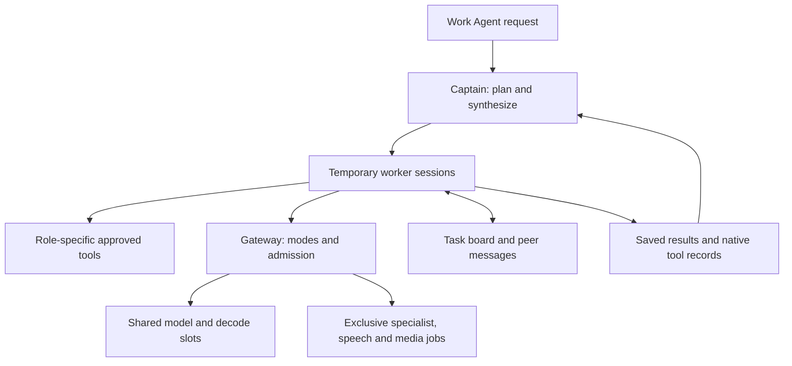

# The captain and temporary workers

## What you use

Open **Start Work Agent.command** and make one request. OpenCode starts in Plan,
with the captain as your main agent. It can answer a simple question directly,
or assign independent parts of a larger request to temporary workers. It keeps
ownership of the request and produces the final combined answer.

Plan is read-only for workers. Switch to Build for implementation work. A coding
worker still asks for native approval before an edit or command. The coordinator's
existing Office, file, PDF, browser, image and speech tools remain available in
their existing permission profiles.

The conversation and Discord interfaces use the same OpenCode harness, so they
also get the captain. Ordinary Open WebUI chat remains its existing native tool
loop; selecting the Captain model there selects the shared inference profile,
but does not create OpenCode worker sessions. Use the Work Agent for the team.

## How a request proceeds

1. **The captain decides whether delegation helps.** A short fact or a tightly
   dependent task stays with it. There is no automatic committee for every question.
2. **It defines a cohort of one to five workers.** Each assignment has an ID,
   tool profile, distinct objective, constraints, relevant evidence and a deliverable.
3. **The system creates separate native OpenCode sessions.** The sessions share
   the same model weights. Their instructions and conversation contexts are separate.
4. **Workers run together.** Native OpenCode owns each worker's inference/tool
   loop. A shared gateway scheduler admits compatible text requests concurrently.
5. **Workers publish findings and send focused messages.** The task board records
   objectives, status, sources, messages and result paths. Messages are evidence;
   they cannot change another worker's permissions or create another worker.
6. **The cohort returns to the captain.** It reads the reports, checks disagreements
   and combines the work. If another stage is needed, it can create a new cohort
   using the first cohort's results. Dependent stages start after their inputs arrive.
7. **Finished workers can be retired.** `team_retire` deletes their native session
   histories while preserving reports. The inference backend may retain allocated
   KV buffers for reuse; deleting a session does not promise an immediate reduction
   in physical RAM.

## Worker roles

The captain can tailor an assignment into roles such as patch researcher,
matchup reviewer or API analyst. The tool permissions come from five fixed
templates; a model cannot invent new privileges.

| Profile | Tools | Typical work |
| --- | --- | --- |
| Researcher | Existing VPN search and page reader; team communication | Current public sources, patch notes, evidence gathering |
| Analyst | Project read/glob/grep, PDF reading; team communication | Reasoning, comparison, planning and synthesis |
| Coder | Project reads; approved edits and commands in Build; team communication | Implementation, debugging and actual tests |
| Writer | Project/PDF reads; team communication | Compose a draft from the supplied sources |
| Reviewer | Project/PDF reads; team communication | Check assumptions, completeness, contradictions and code |

The researcher uses stateless VPN retrieval. The captain keeps the existing
Playwright browser tools for approved interactive website work. This prevents
several workers from moving the same browser tab underneath one another.
Researchers have no web tools when VPN web access is disabled. A failed VPN
request returns an error; it never falls back to the Mac's ordinary connection.

Only one coder may edit/run commands in a cohort. Other workers can inspect and
review alongside it. Worker instructions tell them to avoid another worker's
objective, while host code rejects duplicate IDs and exactly repeated objectives.
That reduces duplication; semantic overlap still needs the captain's judgment.

Workers cannot delegate, start media jobs, change models, change resource modes,
access account tools or expand their project scope. Existing native permissions
remain authoritative. Approved shell commands still run with your Mac user's
privileges; OpenCode is not an OS sandbox.

## Example: a videogame question

For “Which build should I use against these opponents in the current patch?”:

- A researcher checks patch notes and collects source URLs.
- An analyst compares build options against the opponents.
- A reviewer challenges the assumptions and looks for uncovered counters.
- The captain reconciles the findings and writes one recommendation.

If build analysis requires the patch findings first, the captain runs that
research as the first cohort and supplies it to a later analysis/review cohort.
A writer can then compose a longer guide. It does not have to rediscover the evidence.

## Concurrency and memory

There are up to **five workers plus the captain as a logical session**. The
captain usually waits during a cohort, so it does not consume a generation slot
while its workers generate. A single task team is admitted at a time within the
OpenCode process. Other ordinary requests still pass through the gateway.

| Setting | Default |
| --- | ---: |
| Maximum workers per cohort | 5 |
| Maximum worker attempts per explicit user turn | 12 |
| Normal shared text requests | 2 |
| Max shared text requests | 5 |
| Each worker's model steps | 12 |
| Each worker's tool attempts | 24 |
| Each worker's deadline | 20 minutes |
| Team messages/findings per turn | 64 |
| Gaming | No Work Agent team; eligible small chat only |
| Active realtime audio | Shared inference reduced to one request |

Failed and cancelled tasks consume attempts. Retries need a new task ID and a
new concrete objective, and remain within the same turn budget. Synthetic
continuations and reconnects cannot reset the budget. Restart recovery marks
unfinished tasks interrupted instead of silently rerunning their edits.

Compatible text requests share one model runner. A different model or context
profile, media generation, conversation startup or resource-mode change acquires
an exclusive gateway lease. It waits for active text work to finish before
unloading model memory. A queued exclusive job blocks later readers from overtaking
it indefinitely. A mode change invalidates queued old requests immediately and
blocks workers' next tool operation.

The standard Ollama configuration uses a second loopback server on port 11436
for the shared captain model, with up to five parallel requests. The existing
specialist server on 11435 retains one-request allocation. Both refer to the same
Ollama artifact directory; model files are downloaded once. The gateway unloads
outgoing runners before switching, so this does not permit two resident model
copies. Keeping parallel settings separate avoids multiplying the old 32K
specialist contexts by five.

## Selecting MiniCPM on the new Mac

Use **Install Local AI with MiniCPM Captain.command** from the same installer
ZIP. It runs the full installer with `--minicpm-captain`.

It builds the native `llama-server` from upstream llama.cpp at
commit `1b70350c92563449576bcbbf552994b1d1ed847d`. It selects the official
**standard mixed-Q3 MiniCPM-V 4.7 35B-A3B GGUF**, plus its vision projector.
The model download is resolved to an immutable Hugging Face snapshot, and each
file is checked against its full LFS SHA-256. A changed artifact layout fails
explicitly instead of silently selecting another quantization.
On a fresh Mac it starts Apple's Command Line Tools installation if needed and
waits for you to approve that system installer. Missing CMake is installed into
Local AI's private Python environment; Homebrew is not required for this step.

The desktop model is served by one gateway-owned process on port 11437 with
continuous batching, five slots, Jinja function-call formatting and no automatic
context shifting. The initial MiniCPM context is **16K per request**, so the
server's total context allocation is 80K. The gateway still caps output by mode.
Weights are shared across all slots; inference is not five independent model loads.
The server starts on demand and stops before specialist/media transitions.
It also releases the shared model after the configured idle retention period
(initially 120 seconds), without interrupting active or queued model work.

This deliberately uses the desktop whole-model artifact. The phone's `-les`
file and forty streamed expert shards are a separate demo-specific format.
Concurrent serving of that exact phone cache was not established. A 32GB Mac
can instead attempt the roughly 16.6GB standard quantized model/projector with
shared RAM residency and context buffers. Actual memory pressure and throughput
remain unmeasured until the Mac is available. Five slots are a configuration
ceiling, not a promise of five fast generation streams.

The MiniCPM selection maps coordinator, analysis and coding roles to the shared
model. Ordinary writer workers also use MiniCPM. The dedicated 32K essay/scaffold
profile retains its existing 4B weights and serial contracts. The stock 9B analyst
and 12B coder are removed from the subsequent download plan. The same 4B weights
also provide Gaming and lightweight fallback. Existing
weights are not deleted. Image/video generators, speech, transcription and
retrieval dependencies still serve distinct functions and are not replaced by
a vision-language model. This change does not establish that MiniCPM writes
better code than the old specialist.

The ordinary installer also includes the captain system using the existing 4B
coordinator as its shared model. No additional model is downloaded per worker.

## State, reports and controls

- Task accounting: `work-agent/state/captain.json`, private local JSON.
- Full worker results and native tool records: `.local-ai-team/` inside the
  project copy. Those files are excluded from the project's Git baseline/patches.
- `team_board`: inspect task progress, findings and report paths.
- `team_note`: publish a bounded finding to the whole team.
- `team_message` and `team_inbox`: exchange focused messages with assigned peers.
- `team_retire`: delete finished native worker histories and preserve reports.

These artifacts are plaintext local state. They are outside the encrypted vault
and may contain supplied project evidence. They are not shared across unrelated
projects or user turns. Reports contain execution records; model claims still
need review. Native tool success does not prove that a test was adequate.

The `captain` section of `control/config.json` controls model selection and
limits. Stop Local AI before editing it. `enabled: false` restores sequential
Work Agent delegation; for a MiniCPM single-model installation, restore
`config.before-minicpm-captain.json` first to recover the previous specialist
mapping. Rerunning the installer preserves an explicit disabled setting.
Scoped desktop/external automation continues to use its independent restrictive
profile and disables the captain tools and workers.

## What was checked before the Mac arrives

Authoring checks exercise parallel native-session dispatch with simulated model
responses; task and message budgets; duplicate/replayed requests; Plan/Build
permissions; mode invalidation; role configuration; report preservation;
retirement; shared gateway requests; exclusive barriers; GGUF integrity and
context allocation; usage/tool-call translation; and existing feature regressions.

The follow-up audit adds hard host-side inference-step accounting, normalized
MiniCPM image delivery, preserved native tool-call IDs, mode checks after cold
startup, resumable standalone model downloads and checks of every text backend
after model/media handoffs. See [Environment audit](ENVIRONMENT-AUDIT-2026-10-14.md).

The authoring host does not run a Mac GPU. GitHub's macOS runner has successfully
built the pinned native MiniCPM binary. Tests do not measure
MiniCPM's real tool reliability, coding quality or five-slot throughput. The
installer's native acceptance and the supplied captain check verify real model
and OpenCode calls on the new Mac. A failure remains a failure, never an inferred
performance result.

## Source references

- [MiniCPM app formats and requirements](https://github.com/OpenBMB/MiniCPM-V-Apps)
- [Pinned MiniCPM desktop usage](https://github.com/ggml-org/llama.cpp/blob/1b70350c92563449576bcbbf552994b1d1ed847d/docs/multimodal/minicpmv4.7.md)
- [Pinned native server and parallel decoding](https://github.com/ggml-org/llama.cpp/blob/1b70350c92563449576bcbbf552994b1d1ed847d/tools/server/README.md)
- [Ollama concurrency and context allocation](https://docs.ollama.com/faq)
