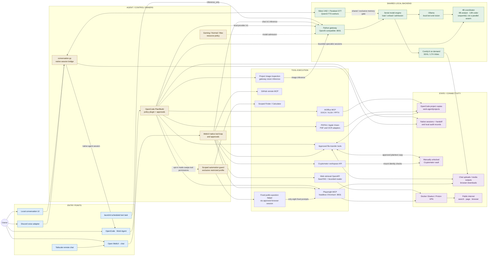
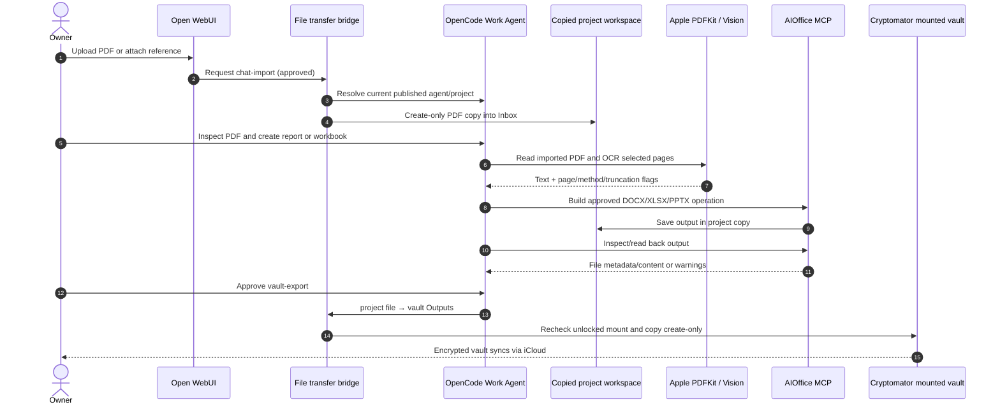
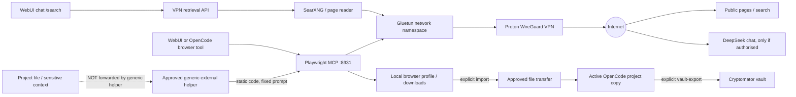

# LOCAL AI: connected system map

**Source:** `main`, integrated release `2026-10-09-integrated-1`.  
**Inspected repository tree:** `f62d85478126589bae4128fbc56856fcee41f0e7` (9 October 2026).  
**Purpose:** Show **connections**, not merely a feature inventory. These diagrams map calls and data movement recorded in the repository and are **not proof that the owner's Mac has passed live acceptance**.

[Archived first overview SVG](archive/2026-10-09-original-overview.svg) | [Current release README](../../README.md) | [Native acceptance](../RELEASE-VALIDATION.md)

## 1. System wiring: who connects to what

The two interactive agent surfaces are **separate tool loops**. They share one gateway and serial local inference engine. Arrows point from the caller/producer to the receiver. Multiple alternative routes do not imply that a single operation traverses every node.

**Diagram caveat:** The team-role arrow is a **logical selection**, not a direct network call from a policy hook to model weights. Native OpenCode task sessions send inference through the same gateway; the local model engine loads one heavy model at a time. The optional restricted automation profile **replaces** normal effectful tool permissions; it does not grant an additional unrestricted path.

## 2. Explicit paths through the code

| What you do | Actual ordered path | Boundary or artifact |
|---|---|---|
| Ordinary chat | Open WebUI → WebUI tool loop → `http_api.py` → `model_engine.py` → Ollama → WebUI | WebUI owns tool execution; gateway owns inference admission |
| Work Agent task | OpenCode Plan/Build → `opencode-team.mjs` policy → gateway `/v1` → engine → selected Ollama model → native session | Agent edits only its copied project, after native permission checks |
| Analyst or coder handoff | Coordinator OpenCode session → bounded task child → same gateway → analyst 9B / coder 12B → report in `.local-ai-handoffs` → coordinator | Handoffs are sequential, max two attempts per user turn |
| Image/video request | WebUI direct route or OpenCode `local_image/local_video` → authenticated gateway media route → serial engine → ComfyUI → media output | Normal/Max for images; Max only for video |
| Normal PDF inspection | WebUI upload filter → Apple PDFKit/Vision native loader; or OpenCode `projectpdf` MCP → local PDF reader | No cloud OCR; page limits and incomplete OCR labels |
| Office file | OpenCode → office MCP relay → sandboxed AIOffice binary → current project copy | Plan inspection, Build writes require approval |
| Web search | WebUI OpenAPI tool or `/search` → web retrieval bridge → SearXNG / reader container → Gluetun/Proton → internet → cited evidence | No host-side fallback after VPN loss |
| Browser navigation | WebUI or OpenCode native tool integration → local Playwright MCP → Chromium container → Gluetun/Proton → site | Separate dedicated local browser profile/output folder; live exit/VPN checks pending |
| Vault access in chat | WebUI workspace OpenAPI → gateway `vault_tools.py` → mount-checked Cryptomator vault | Owner must manually unlock vault; no silent folder fallback |
| Document handoff | Chat upload / browser output / media output / mounted vault → explicit transfer tool → current OpenCode project; output → explicit vault export | Approved create-only copies; import from vault becomes plaintext |
| Real-time voice | Local browser mic → conversation bridge → Silero VAD → Parakeet STT → native OpenCode session → gateway Ollama → Qwen3-TTS → playback | Resident speech workers overlap only eligible 4B coordinator |
| Discord voice | Private Discord channel → Node adapter → conversation bridge → same native OpenCode session + local speech workers → Discord voice | Discord carries voice and conversation text; not wholly local transport |
| Scoped desktop | OpenCode restricted profile → guard → approval → fixed AppleScript → approved Finder navigation / Calculator | Not unrestricted desktop automation, no arbitrary clicks |
| External model helper | OpenCode restricted profile → guard → fixed public question → exact local approval → existing VPN Playwright → DeepSeek → untrusted text return | No arbitrary context/project data sent; provider permission required |
| Scheduled task | launchd job → scheduled request with `inference_only` → gateway → eligible local model → saved partial/complete output | All tool commands/routes blocked for scheduled inference |
| Remote chat | Tailscale private device → limited WebUI/media entry → gateway backend | Does not expose OpenCode or browser controller to remote devices |
| Resource switching | Local mode page → authenticated gateway `/control/mode` → admission/queue guard → unload Ollama, stop ComfyUI → eligible next model | Global mode; not an OS RAM quota |

## 3. Cross-system document journey

## 4. Browser and private-network journeys

The **external helper never receives project text via this adapter**; it accepts only eight prewritten public questions and treats its returned text as untrusted. Separate direct VPN browser operations are not equivalent to this restricted adapter.

## 5. Scope and evidence

- **Code present on `main`:** gateway/model engine, Open WebUI tools, OpenCode coordinator/plugin, bounded specialists, Office/PDF/vision MCP tools, media pipeline, conversation and Discord adapters, VPN browser and retrieval, transfer bridges, Cryptomator mount-checked API, scheduler and restricted control adapters.
- **Opt-in configuration:** VPN/Docker, browser integration, vault manual unlock, desktop control, generic external delegation with provider authorisation and selectors, login startup and scheduled tasks.
- **Live validation outstanding according to the release:** owner's Mac installation; GPU and unified memory behavior; microphone/Discord calls; actual browser VPN exit and tunnel-drop; Finder/native approvals; external provider compatibility; browser-to-Office-to-vault acceptance. Code and unit tests are not equivalent to these checks.
- **Trust boundaries:** local project copies and handoff logs are plaintext; vault imports disclose plaintext into the project; sandboxed AIOffice is denied network but the project workspace is application-scoped rather than a complete OS filesystem sandbox; approval of arbitrary OpenCode shell commands retains Mac-user privileges.

### Files that justify these relationships

| Slice | Implementation or primary documentation |
|---|---|
| Gateway and shared backend | `installer/payload/gateway.py`, `http_api.py`, `model_engine.py`, `docs/GATEWAY-STRUCTURE.md` |
| Entry points and process supervisor | `installer/runtime.py`, `work_agent.py`, `conversation.py`, `discord-adapter.mjs` |
| Models, delegation and limits | `installer/opencode-team.mjs`, `handoff-contract.mjs`, `docs/WORK-AGENT.md`, `MODEL-TEAM-AND-HANDOFFS.md` |
| PDF / Office / vision | `installer/pdf_mcp.py`, `office_mcp.py`, `vision_mcp.py`, `docs/OFFICE-TOOLS.md`, `REQUIRED-CAPABILITIES.md` |
| File transfer / vault | `installer/transfer_mcp.py`, `file_workflows.py`, `installer/payload/vault_tools.py`, `docs/ENCRYPTED-WORKSPACE.md` |
| Browser / web routing | `installer/browser_setup.py`, `web_access.py`, `installer/payload/web_client.py`, `docs/BROWSER-MCP.md`, `WEB-ACCESS.md` |
| Scoped adapter | `installer/control_policy.py`, `automation_mcp.py`, `delegation_browser.py`, `docs/SCOPED-AUTOMATION.md` |
| Verification | `docs/RELEASE-VALIDATION.md`, `docs/DEPLOYMENT.md` |

This is an architecture map reconstructed from the inspected repository revision, not a dynamically generated call graph. When code changes, these source-to-target relationships should be rechecked.
